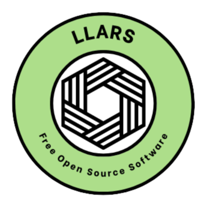

<h1 align="center">
  <strong>LLARS</strong>
</h1>

<h3 align="center">
  <strong>L</strong>ocal <strong>L</strong>ibrary of <strong>A</strong>utomated <strong>R</strong>outines and <strong>S</strong>cripts
</h3>

  
  

  

  

---

## What is LLARS?

LLARS is a free and open-source AutoHotkey framework and script-building toolkit for **RuneScape 3 (RS3/EoC)** and **Old School RuneScape (OSRS)**. Its included scripts are for RS3; the LLARS framework and Script Generator can also be used to create and run OSRS-specific scripts.

It provides a shared framework, Creator API, reusable functions, configuration system, GUI tools, and supporting libraries for creating and running LLARS-compatible scripts.

LLARS is designed for both:

- **Script Users** — Configure and run existing LLARS-compatible scripts.
- **Script Creators** — Build, maintain, and expand automation using the LLARS framework.

---

## Table of Contents

- [Important Note for Script Use](#important-note-for-script-use)
- [LLARS Documentation](#llars-documentation)
  - [Setup Guide](#setup-guide)
  - [Script Creator Documentation](#script-creator-documentation)
  - [Config.ini Instructions](#configini-instructions)
  - [Configuration Backup & Restore](#configuration-backup--restore)
- [Requirements](#requirements)
- [Support](#support)

---

## Important Note for Script Use

> ### Script Configuration
>
> **You do not need to make changes to the script itself.**
>
> Normal script configuration should be performed through the **LLARS GUI**, the root `LLARS Config.ini`, and any script-local `Config.ini` provided for that activity. Some scripts do not require a local `Config.ini`.

**The included scripts are designed for RuneScape 3 (RS3/EoC) only.** LLARS recognizes Old School RuneScape (OSRS) through the official client and RuneLite, and creators can use its framework and Script Generator to build OSRS scripts. **No ready-made OSRS scripts are included.**

Make sure to use these scripts only with the appropriate version of the game and understand the risks and responsibilities associated with game automation.

Before using LLARS, please read the **[LLARS Usage & Safety Tip](Documentation/LLARS%20Usage%20%26%20Safety%20Tip.md)**.

The project disclaimer is included at the bottom of that file.

---

## LLARS Documentation

LLARS includes documentation for both first-time users and script creators.

### Setup Guide

Before setting up or running a script, **please read the [LLARS - Setup Guide](Documentation/LLARS%20-%20Setup%20Guide.pdf)** included with the project.

The LLARS Setup Guide is the primary guide for learning how to:

- Set up LLARS and its scripts
- Configure a script through the LLARS GUI
- Configure hotkeys, coordinates, and colors
- Understand the root LLARS configuration and script-local `Config.ini` files when a script provides one
- Understand required and optional settings
- Run scripts correctly
- Understand timer and run-count settings
- Pause, resume, and stop scripts
- Troubleshoot common setup problems
- Keep your RuneScape layout configured correctly for the script

The Setup Guide is written for **first-time users** and provides the information needed to set up and use LLARS scripts without requiring users to modify the script itself.

### Script Creator Documentation

LLARS is built around a shared framework and Creator API used by the scripts in this repository.

Script creators who want to create or update LLARS-compatible scripts should read:

- **[LLARS - Script Creator & Framework Guide](Documentation/LLARS%20-%20Script%20Creator%20%26%20Framework%20Guide.pdf)**
- **[LLARS - Script Creator Library](Documentation/LLARS%20-%20Script%20Creator%20Library.pdf)**

These are the recommended resources for new and maintained LLARS scripts. They cover the current Creator API, framework behavior, reusable components, templates, and copy/paste patterns used throughout the project.

For creators who intentionally want to use more traditional AutoHotkey v1 methods or maintain older LLARS-style code, the project also includes:

- **[LLARS - Legacy Script Creator Guide](Documentation/LLARS%20-%20Legacy%20Script%20Creator%20Guide.pdf)**

The Legacy Script Creator Guide covers lower-level and traditional AutoHotkey patterns separately so the current Creator API documentation can stay focused on the framework used by new LLARS scripts.

### Config.ini Instructions

When setting up a script for the first time, read its **Information** text and, if the script folder includes one, its `Config.ini`.

A script-local `Config.ini` may contain important instructions and information specific to that activity. Some scripts do not need a local `Config.ini` because their behavior is driven by shared LLARS settings or by the script itself.

> **Pay close attention to the instructions and comments above each section.**
>
> They may explain how a setting works or exactly what should be selected when configuring it through the LLARS GUI.

Different scripts can require different configurations—or no script-local configuration at all—so **do not assume that the settings or instructions from one script apply to another**.

When a supported activity has both versions, Script Selector offers **Normal** and **Menu Entry Swapper** variants. Normal scripts remain under `Scripts`; Menu Entry Swapper variants are kept separately under `Scripts - Menu Entry Swapper` and rely on the bank interaction to load the last preset instead of pressing a Bank Preset hotkey. The Selector uses the shorter `- MES` suffix for these alternate entries while the type filter keeps the full Menu Entry Swapper family name. Use the Selector's type filter to show either family.

For normal setup, use the **LLARS GUI whenever possible** rather than manually editing configuration files.

### Configuration Backup & Restore

LLARS includes the existing backup and restore tools under the **[Backup](Backup/Config%20Backup%20%26%20Restore.md)** folder. They protect the shared `LLARS Config.ini` and script-local `Config.ini` files, and the same backup tool is used automatically before an LLARS update download begins.

### Header Appearance

The default root `[GUI Header]` section includes `mode=sequential`; choosing Random or Fixed in Header Style saves `mode` in `LLARS Config.ini` without changing your existing script settings.

The Script Selector includes **Header Style** for choosing how the LLARS header artwork changes between sessions. **Sequential** (the default) advances through the headers, **Random** avoids immediately repeating the previous header when possible, and **Fixed** keeps the selected design. The same **Header Style** control is also available inside an individual script's **Setup** menu directly below **Check Setup**, without changing the active session. Use **Previous** and **Next** to preview available artwork, then **Save preference** to keep the mode and (for Fixed) selected design; **Cancel** does not save. A script already running retains its current header.

To add your own header, place a PNG named `header_your-name.png` inside `Assets/UI` and restart LLARS. The six original designs remain first in their original order. Four more bundled designs follow: Digital Wave, Polygon Grid, Nebula Cloud, and Shadow Botanica. Your own additional valid images follow alphabetically. The recommended size is **1460 x 194 pixels**, with text-friendly contrast near the center. Custom images must be wide PNG files with a valid decoded image (width 400-4096 px, height 60-1024 px, aspect ratio 4:1 to 12:1, maximum 6 million pixels and 20 MB). Name the image using letters, digits, dashes, or underscores, up to 64 characters after `header_`. Invalid, unreadable, or ambiguous additional images are skipped. Removing a custom design does not delete your saved configuration: LLARS falls back to an available design when needed. All ten bundled header files are required and should not be renamed or replaced; add separate custom files instead.

### Importing a standalone script into Script Selector

**Import Scripts** in the Selector lets you opt in to a script you already trust. Choose the script's `.ahk` file, enter its display name, category, setup difficulty and description, and select **Import Copy**. LLARS accepts `.ahk` files from outside LLARS or from within LLARS (including `Scripts`), except those inside the reserved `Scripts/Custom` folder. For normal script subfolders it copies the **entire containing folder** (including a local `Config.ini`, assets and relative includes) into `Scripts/Custom/Imported/<original-folder-name>`. For a `.ahk` directly in the LLARS root, `Scripts` root or `Scripts - Menu Entry Swapper` root, it copies **only that .ahk** into a new managed folder named after the file stem; scripts needing companion files should be placed in their own subfolder first. Registration then uses the **same Creator/Selector registry**. The managed folder keeps the original parent directory name (including spaces); LLARS will refuse unsafe names rather than silently rename them. The original folder remains unchanged; no script is executed during import. Enter your own description (required); the importer does not substitute a generic description. It is saved as Selector metadata, including multiple lines if entered. The existing Creator registry preserves those line breaks. Imports are local-only, limited to 300 files and 32 MB, and reject junctions, symlinks and ambiguous targets. A standalone script is still launchable without being imported. Importing does not establish trust or compatibility; review its code and instructions first.

**Import Scripts** always opens as a fresh, empty form with **Select existing import** as the default management choice, regardless of the selected script in the main Selector. After a successful import, the dialog stays open, clears the source and metadata, and refreshes its management choices so the imported entry can be selected for editing if desired. To manage an imported entry, choose it explicitly from the **Manage existing** list. **Edit Details** changes Selector metadata only; **View Folder** opens the managed copy; **Unregister** removes only its registry entry and leaves both folders and all configs untouched. Files inside `Scripts/Custom` cannot be re-imported; unregistering leaves the managed copy on disk, so keep a separate source copy for any subsequent new import. Creator-generated entries and LLARS's supplied scripts are not managed by these actions. The imported entry appears immediately in the Selector with the refreshed All Scripts view, ready to select; its saved description appears in the standard information panel. The Selector's existing search, category, Favorites, Recent and Normal type filters also include imported entries. Existing imports retain their current on-disk folder names; importing a new copy never renames them. If your source folder is larger than the import limit, keep using the script standalone rather than trying to bypass the safety checks.

### Input diagnostics and non-gameplay readiness

**Input Settings → Test AHI** inspects driver/runtime readiness, the configured mouse and keyboard output routes, and observed physical mouse activity without sending any click or key to RuneScape. A physical mouse ID different from the selected AHI output ID can be intentional and is advisory, not proof of a broken device. The Developer/support diagnostics distinguish configuration, focus, input readiness, transport, cursor alignment and verified-click confirmation failures. A configuration problem means no verified-click failure was observed; a confirmation failure means a click was attempted but the expected result was not detected. For help, use the suggested next step and review the sanitized support ZIP before sharing it.

### Safe manual upgrade and custom files

The built-in update check **backs up configuration and downloads a new release ZIP**; it does not install or merge the download automatically. Before extracting a newer LLARS release, retain a complete copy of your existing installation. Extract the new release into a **separate folder** rather than overwriting your active folder. Copy back your personalized root `LLARS Config.ini`, script-local `Config.ini` files, Creator-created scripts and registry, and any user-added `Assets/UI/header_*.png` files after checking for filename conflicts. The configuration backup now also stages valid user-added header PNGs, the Creator registry, and managed/registered script folders into a checksummed `User Files` snapshot. On restore it **never overwrites existing different user files**: resolve a reported conflict manually before retrying. It is not a substitute for a complete copy of an installation, particularly for standalone unregistered scripts and projects outside the registry. Do not overwrite newer shipped scripts or documentation without comparing them. Verify your custom content and settings before retiring the old folder.

---

## Requirements

| Requirement | Version / Information |
| :--- | :--- |
| **Operating System** | Windows |
| **AutoHotkey** | v1.1.37.02 |
| **Game clients** | RuneScape 3 (RS3/EoC); Old School RuneScape (official client or RuneLite). Included scripts: RS3 only. |
| **Script Format** | Uncompiled `.ahk` scripts |

LLARS is built for **AutoHotkey v1**, and the scripts are provided in an uncompiled format.

If you haven't installed AutoHotkey yet, download the required **v1.1.37.02** release from the official AutoHotkey website.

  <a href="https://www.autohotkey.com/download/1.1/AutoHotkey_1.1.37.02_setup.exe">
    <strong>Download AutoHotkey v1.1.37.02</strong>
  </a>

> ### AutoHotkey Version
>
> LLARS is built for **AutoHotkey v1.1.37.02**.
>
> AutoHotkey v2 is not a drop-in replacement for AutoHotkey v1 scripts.

### Input backend

LLARS recommends **AutoHotInterception (AHI)** for mouse and keyboard input. The AHI runtime and Interception installer are bundled with LLARS, and a clean installation is offered automatically when AHI is not present. Installation requires an Administrator prompt and one Windows restart.

**Standard AutoHotkey** remains available as a fallback under **Information > Input Settings**. Input Settings shows the configured backend, active input route, AHI driver/device routes, last mouse/keyboard transport, startup timing, and fallback state. It also provides a non-invasive **Test AHI** health check plus the existing enable/repair and uninstall controls.

---

## Support

For questions, setup help, script support, or information about the LLARS framework, join <a href="https://discord.gg/Wmmf65myPG">**Gubna's Script Support Discord Server**.

**Discord Contact:** `Gubna`  
*Formerly `Gubna#0001`*

  <strong><a href="https://discord.gg/Wmmf65myPG">Join the Discord Server</a></strong>

